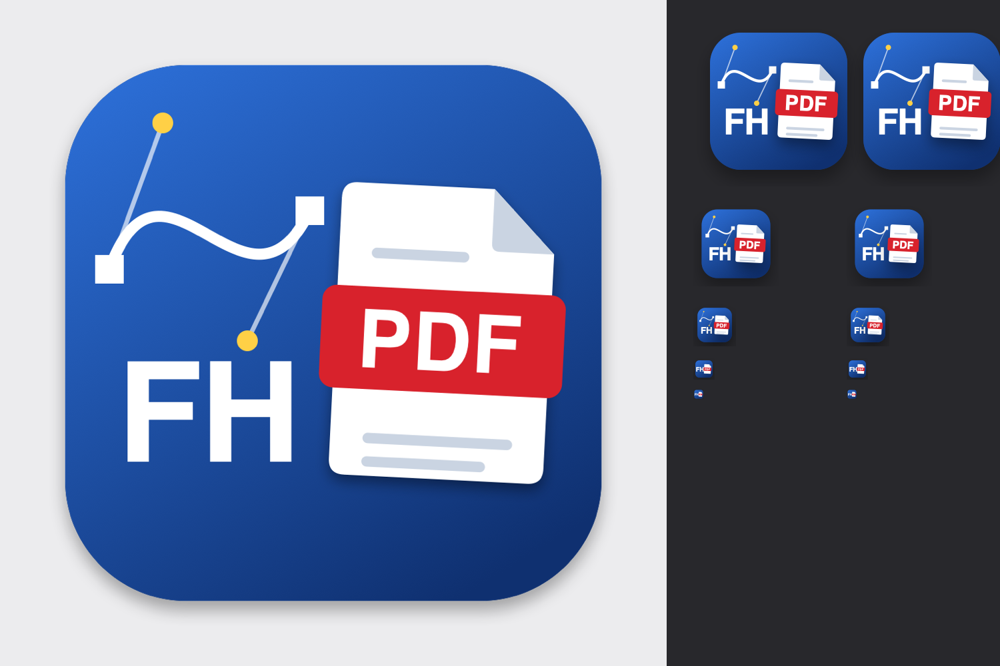

# FreeHand a PDF

A small native Mac app that turns old **Macromedia/Aldus FreeHand** files into **PDF** or **Illustrator (.ai)**, without FreeHand and without LibreOffice.

FreeHand was discontinued long ago and current versions of Illustrator often refuse its files. If you have an archive of them, this may help you get your work back.

*[Italiano più sotto](#italiano)*



## What it does

- **Converts** FreeHand files to PDF, or to `.ai` keeping layers, layer names and hidden layers.
- **Recognizes files by content**, because old Mac files often have no extension. If a file isn't FreeHand it tells you what it is (TIFF, PDF, EPS…) and makes a correctly named copy.
- **Searches a folder or a NAS** for FreeHand files, so you can pick the ones to convert.
- **Reports missing fonts** and keeps their original names, so Illustrator's *Find Font* can show which font to replace.

Your files are never overwritten: output goes next to the original, as `Name (2).pdf` if the name is taken.

## Build

There is no prebuilt download: an unsigned app downloaded from the internet would be blocked by macOS.

You need the Xcode command line tools and [Homebrew](https://brew.sh). Homebrew only downloads two prebuilt libraries into `build/`: nothing is installed on your system.

```bash
git clone https://github.com/pauerbuk/Freehand-a-PDF.git
cd Freehand-a-PDF
./build.sh
open build
```

Drag `FreeHand a PDF.app` wherever you like. The built app uses the libraries for your macOS version and processor, so it may not run on older Macs. It has only been tested on Apple silicon with macOS 26.

## Usage

Drop files or folders on the window or on the app icon, or click the window to choose them. Use **Cerca file FreeHand…** to search a folder. The interface is in Italian.

From Terminal:

```bash
"build/FreeHand a PDF.app/Contents/MacOS/FreeHand a PDF" --convert file1 file2
"build/FreeHand a PDF.app/Contents/MacOS/FreeHand a PDF" --convert --ai file1
"build/FreeHand a PDF.app/Contents/MacOS/FreeHand a PDF" --convert --livelli-nascosti file1
"build/FreeHand a PDF.app/Contents/MacOS/FreeHand a PDF" --search /path/to/folder
```

## Limitations

Please check the result of anything important: there is no FreeHand here to compare against, and testing was done on one person's archive.

- **Tested on** real FreeHand 8 and 11 files. Other versions were only opened in a large batch, without checking each result.
- **Very old files (`FHD2`, around 1990):** this reader was worked out from **a single file** and is experimental. Page size isn't decoded yet: it uses A4 if the drawing fits, otherwise a custom page.
- **Fonts** must be installed on your Mac, otherwise they are substituted with a warning. Line breaks and text position may differ slightly from the original.
- **PDF:** colors are RGB. Hidden layers can be included, but layers are flattened. Tile fills become light gray, shadows lose their blur and arrowheads use a generic shape.
- **`.ai`:** uses the old text-based Illustrator format, so Illustrator shows *[Converted]* and may ask to update the text. Colors are converted from RGB: blacks and grays go to K only, others are approximate, and spot colors are lost. Gradients become solid, image fills become gray; embedded images, arrowheads and transparency are dropped. Most of these show a warning.
- **Line joins and caps** are always mitered and butt.
- **Very large files** over about 260,000 objects will fail with an error.
- **Search** only looks at files with no extension or with a `.fh…` extension.

Sample files are welcome, especially from versions before FreeHand 8, as long as they contain no private or client material.

## How it works

Reading is done by [libfreehand](https://wiki.documentfoundation.org/DLP/Libraries/libfreehand) with a [small patch](patches/libfreehand-0.1.4.patch), downloaded and applied at build time. The patch:

- reads files with more than about 130,000 objects, which the original fails on;
- scales stroke widths with their object, so shrunk artwork doesn't look bolder;
- treats inner shapes of compound paths as holes;
- passes clipped content as real drawing, plus layer names and visibility.

The drawing code, the `.ai` writer and the `FHD2` reader are in [`Sources/FHEngine.mm`](Sources/FHEngine.mm).

## License

[Mozilla Public License 2.0](LICENSE). The built app also contains librevenge (MPL 2.0 / LGPL 2.1) and lcms2 (MIT), and their license files are copied into the app.

This project isn't affiliated with or endorsed by Adobe. FreeHand and Illustrator are trademarks of Adobe; they're named here only to describe which files this tool works with.

---

## Italiano

Una piccola app per Mac che converte i vecchi file **FreeHand** in **PDF** o **Illustrator (.ai)**, senza bisogno di FreeHand né di LibreOffice.

**Cosa fa**

- Converte in PDF, oppure in `.ai` mantenendo livelli, nomi e livelli nascosti.
- Riconosce i file dal contenuto, anche senza estensione. Se un file non è FreeHand ti dice cos'è e ne crea una copia con il nome giusto.
- Cerca i file FreeHand in una cartella o su un NAS, così scegli quali convertire.
- Segnala i font mancanti e ne conserva il nome, così in Illustrator puoi vedere quale sostituire.

Non sovrascrive mai nulla: il file creato va accanto all'originale.

**Come compilarla**

Non c'è un'app già pronta da scaricare, perché macOS la bloccherebbe. Servono gli strumenti da riga di comando di Xcode e Homebrew, poi:

```bash
git clone https://github.com/pauerbuk/Freehand-a-PDF.git
cd Freehand-a-PDF
./build.sh
open build
```

**Limiti**

Controlla sempre il risultato dei file importanti: i limiti sono elencati nella sezione *Limitations* qui sopra. In particolare, la lettura dei file molto vecchi (`FHD2`, circa 1990) nasce da un solo file ed è sperimentale.

Il progetto non è affiliato ad Adobe. FreeHand e Illustrator sono marchi di Adobe.
